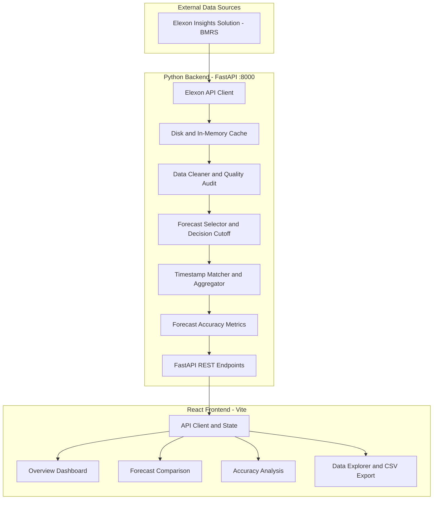

# WindForecast Analytics: UK National Wind Generation Day-Ahead Forecast Accuracy (January 2026)


**WindForecast Analytics** is a full-stack analytics platform for evaluating UK national wind-generation day-ahead forecasts against actual wind generation using official Elexon Insights Solution (BMRS) data.

The platform combines a Python FastAPI analytics engine with a React and TypeScript dashboard to evaluate forecast accuracy, enforce configurable purchasing-decision cutoffs, inspect forecast publication histories, and audit data quality.

> **Evaluation scope:** January 2026 purchasing-decision dates, using a configurable Day-Ahead decision cutoff. The default 11:00 UTC cutoff is an operational modelling assumption, not a universal exchange deadline.

---

## Table of Contents

- [1. Project Overview](#1-project-overview--business-problem)
- [2. Key Features](#2-key-features)
- [3. Technology Stack](#3-technology-stack)
- [4. System Architecture](#4-system-architecture)
- [5. Official Data Sources](#5-official-data-sources)
- [6. Evaluation Scope and Decision Cutoff](#6-evaluation-scope-and-decision-cutoff)
- [7. Data Cleaning and Resolution Alignment](#7-data-cleaning-and-resolution-alignment)
- [8. Forecast Accuracy Metrics](#8-forecast-accuracy-metrics)
- [9. January 2026 Results](#9-january-2026-results)
- [10. Project Structure](#10-project-structure)
- [11. Prerequisites](#11-prerequisites)
- [12. Local Development Setup](#12-local-development-setup)
- [13. Docker Setup](#13-docker-setup)
- [14. Testing and Reproducibility](#14-testing-and-reproducibility)
- [15. API Documentation](#15-api-documentation)
- [16. Configuration](#16-configuration)
- [17. Deployment](#17-deployment)
- [18. AI Tools Disclosure](#18-ai-tools-disclosure)
- [19. Limitations and Future Improvements](#19-limitations-and-future-improvements)
- [20. Security and Data Integrity](#20-security-and-data-integrity)
- [21. Submission Status](#21-submission-status)

---

## 1. Project Overview & Business Problem

In the United Kingdom wholesale electricity market, energy utilities purchase electricity through day-ahead wholesale markets. Traders and commercial dispatchers must make purchasing decisions before the corresponding electricity is physically delivered.

Wind generation is weather-dependent and variable. Differences between forecast and actual generation can create volume risk, operational uncertainty, and potential imbalance costs.

WindForecast Analytics addresses two questions:

1. **Forecast availability:** What was the latest eligible wind-generation forecast available at the configured purchasing-decision cutoff?
2. **Forecast accuracy:** How closely did that forecast match the actual national wind generation recorded for the corresponding delivery periods?

The application provides a reproducible analytical workflow that:

- Ingests official Elexon wind forecast and generation data.
- Applies configurable decision-cutoff rules.
- Selects the latest eligible forecast vintage.
- Matches forecasts and actuals using delivery timestamps.
- Calculates quantitative forecast error metrics.
- Identifies missing data, duplicate records, and invalid observations.
- Presents the results through an interactive analytics dashboard.
- Exports analyzed observations for further inspection.

The objective is to provide transparent, auditable evidence of forecast performance—not to claim guaranteed trading profits or calculate financial losses without a separate validated market-pricing model.

## 2. Key Features

### Official data ingestion

- Retrieves data from the Elexon Insights Solution (BMRS) API.
- Supports FUELHH actual generation and WINDFOR forecast data.
- Uses bounded date-range chunking and retry handling.
- Supports local caching to reduce repeated requests and improve reproducibility.

### Wind-only generation filtering

Actual generation records are filtered using:

`fuelType == "WIND"`

This excludes other fuel categories from the wind-generation evaluation.

### Decision-cutoff-aware forecast selection

- Supports configurable cutoff hours and minutes.
- Uses publication timestamps to determine forecast eligibility.
- Excludes forecasts published after the decision cutoff.
- Selects the latest eligible forecast vintage.
- Preserves selected publication timestamps for auditing.

### Forecast and actual comparison

- Aligns records using delivery-period timestamps.
- Supports hourly aggregation and half-hourly transparency analysis.
- Reports missing forecasts rather than silently fabricating observations.
- Calculates signed errors and standard forecast accuracy metrics.

### Interactive analytics dashboard

**Overview Dashboard**
- Executive KPI cards.
- Forecast-versus-actual time-series chart.
- Data coverage indicators.
- Resolution selection and commercial interpretation.

**Forecast Comparison**
- Delivery-date filters and date presets.
- Interactive forecast and actual comparison.
- Forecast vintage history inspection.
- Decision-cutoff eligibility visibility.

**Accuracy Analysis**
- Error distribution.
- Residual error trends.
- Largest absolute discrepancies.
- Forecast accuracy metrics.

**Data Explorer**
- Paginated observations table.
- Sorting and filtering.
- Delivery timestamps, forecasts, actuals, cutoffs, and errors.
- CSV export of analyzed records.

### Data quality and provenance

The pipeline is designed to track data cleaning, duplicate resolution, missing records, invalid observations, and data source provenance. Exact counts should be taken from the generated audit artifacts for each run.

## 3. Technology Stack

| Layer | Technologies |
|---|---|
| Frontend | React 18, TypeScript, Vite |
| Visualization | Recharts, Lucide Icons |
| Backend | Python 3.11+, FastAPI, Pydantic |
| Data processing | Pandas, timezone-aware Python datetimes |
| HTTP client | HTTPX |
| Backend testing | Pytest |
| Frontend testing | Vitest, React Testing Library, JSDOM |
| Containerization | Docker, Docker Compose, Nginx Alpine |
| Deployment configuration | Vercel frontend configuration, backend process/container configuration |

## 4. System Architecture

The application follows a layered architecture. The backend handles data retrieval, cleaning, forecast selection, timestamp matching, and metric calculations. The frontend consumes the API and presents the resulting analysis.



### Data flow

1. Request the required FUELHH and WINDFOR data.
2. Normalize timestamps to UTC and validate incoming records.
3. Filter actual generation to wind records.
4. Resolve duplicates according to the documented selection rules.
5. Apply the configured forecast publication cutoff.
6. Select the latest eligible forecast vintage.
7. Match forecasts to actual delivery periods.
8. Aggregate actual generation when hourly evaluation is selected.
9. Calculate accuracy metrics and data quality summaries.
10. Return the results through the REST API for dashboard presentation and export.

## 5. Official Data Sources

The platform uses the official Elexon Insights Solution (BMRS) stream endpoints.

### FUELHH — Actual generation

Endpoint:

https://data.elexon.co.uk/bmrs/api/v1/datasets/FUELHH/stream

Relevant fields:

| Field | Meaning |
|---|---|
| `startTime` | Start of the settlement period |
| `publishTime` | Publication timestamp of the observation |
| `fuelType` | Fuel category |
| `generation` | Recorded generation in MW |
| `settlementDate` | Settlement delivery date |
| `settlementPeriod` | Settlement-period index |

Only records whose `fuelType` is `WIND` are eligible for the actual-generation evaluation.

### WINDFOR — Wind-generation forecasts

Endpoint:

https://data.elexon.co.uk/bmrs/api/v1/datasets/WINDFOR/stream

Relevant fields:

| Field | Meaning |
|---|---|
| `startTime` | Target delivery-period timestamp |
| `publishTime` | Forecast publication or vintage timestamp |
| `generation` | Forecast generation in MW |

The implementation should be checked against the current API schema and the actual returned records before assuming every optional field is present.

**Data provenance:** The application may use live API responses, cached data, or a combination of both. Refer to the run manifest and data quality report to determine which source was used for a particular analysis.

## 6. Evaluation Scope and Decision Cutoff

### Primary analysis: January 2026 decision dates

The primary evaluation covers purchasing-decision timestamps in this interval:

- Start: `2026-01-01 00:00:00 UTC`
- End: `2026-02-01 00:00:00 UTC`, exclusive

Under the configured Day-Ahead D−1 modelling assumption, decisions made in January can correspond to delivery periods extending into February.

The documented expected hourly delivery span is:

- Start: `2026-01-02 00:00:00 UTC`
- End: `2026-02-01 23:00:00 UTC`, inclusive

This represents 744 hourly delivery periods.

**Important distinction:** A January decision-date evaluation is not the same as an evaluation of deliveries occurring strictly during January.

### Alternative analysis: January delivery dates

The application also supports a delivery-date window covering January 2026:

- Start: `2026-01-01 00:00:00 UTC`
- End: `2026-02-01 00:00:00 UTC`, exclusive

Use the configured window mode to distinguish these two evaluations.

### Decision cutoff and forecast eligibility

For a delivery date D, the project models a purchasing decision made on D−1.

The default cutoff is **11:00 UTC on D−1**. This is an operational modelling assumption that can be changed to reflect a separately verified market deadline.

A forecast vintage is eligible when:

\[
publishTime \leq decisionCutoff
\]

The selected forecast is the eligible record with the latest publication timestamp:

\[
F_t = generation_{\,\arg\max(publishTime)}
\]

subject to the eligibility constraint.

Forecast revisions published after the cutoff must not influence the decision-time forecast.

### Configurable cutoff

The analysis script supports hour and minute parameters. For example:

```bash
python backend/reproduce_analysis.py \
  --cutoff-hour 11 \
  --cutoff-minute 0 \
  --window decision \
  --resolution hourly
```

Confirm the available options with the script's help output before using this command with a different configuration.

**Market-rule note:** Do not interpret the default cutoff as an official deadline for every exchange or auction product. Any exchange-specific cutoff must be verified against the relevant official market documentation.

## 7. Data Cleaning and Resolution Alignment

### Timestamp normalization

Incoming timestamps are parsed and normalized to timezone-aware UTC datetimes before matching.

### Invalid observations

Records with malformed timestamps, invalid generation values, or negative generation are subject to validation and auditing. The implementation's actual rules determine which records are rejected and how the reasons are reported.

### Duplicate handling

Duplicate delivery-period records are resolved deterministically according to the implemented data-cleaning rules. The data quality report should identify the number of duplicates handled.

### Hourly aggregation — primary evaluation

FUELHH actual generation is reported at half-hourly resolution, while the documented WINDFOR evaluation uses hourly forecasts.

For hourly evaluation, the project calculates the arithmetic mean of the two half-hourly actual power observations:

\[
A_H = \frac{A_{H:00}+A_{H:30}}{2}
\]

where:

- \(A_{H:00}\) is the first half-hour's average generation in MW.
- \(A_{H:30}\) is the second half-hour's average generation in MW.
- \(A_H\) is the hourly average power in MW.

This is an average of power measurements, not a sum of MW values.

The reported primary analysis contains 744 matched hourly periods. Verify the actual coverage against the generated audit report before relying on that figure.

### Half-hourly transparency mode

The half-hourly mode matches only the half-hour periods supported by the forecast data. Under the documented approach, an hourly forecast is matched to the corresponding `:00` half-hour, while the `:30` period is reported as missing a matching forecast.

No artificial interpolation is used in this mode.

The documented expected coverage is 744 matched periods out of 1,488 half-hourly periods, or 50%.

## 8. Forecast Accuracy Metrics

Let:

- \(F_t\) = forecast generation in MW.
- \(A_t\) = actual generation in MW.
- \(N\) = number of matched observations.

### Signed error

\[
e_t = F_t-A_t
\]

- Positive error: over-forecasting.
- Negative error: under-forecasting.

### Mean Absolute Error (MAE)

\[
MAE = \frac{1}{N}\sum_{t=1}^{N}|F_t-A_t|
\]

MAE measures the average absolute difference between forecasts and actual generation, in MW. Lower values indicate smaller average errors.

### Root Mean Squared Error (RMSE)

\[
RMSE = \sqrt{\frac{1}{N}\sum_{t=1}^{N}(F_t-A_t)^2}
\]

RMSE penalizes large errors more strongly than MAE. It is measured in MW.

### Mean Signed Error (Bias)

\[
Bias = \frac{1}{N}\sum_{t=1}^{N}(F_t-A_t)
\]

Positive bias indicates systematic over-forecasting on average; negative bias indicates under-forecasting on average.

### Weighted Absolute Percentage Error (WAPE)

\[
WAPE =
\frac{\sum_{t=1}^{N}|F_t-A_t|}
{\sum_{t=1}^{N}|A_t|}
\times 100
\]

WAPE measures total absolute error relative to total absolute actual generation. If the denominator is zero, the result must be handled explicitly rather than silently producing an invalid percentage.

### Conditional Mean Absolute Percentage Error (MAPE)

MAPE is calculated only for observations where actual generation satisfies the configured threshold:

\[
A_t \geq 100\text{ MW}
\]

For that eligible subset \(S\):

\[
MAPE =
\frac{100}{|S|}
\sum_{t\in S}
\left|\frac{F_t-A_t}{A_t}\right|
\]

The threshold reduces distortions from near-zero actual generation. It must be disclosed alongside the result because conditional MAPE does not represent every observation.

## 9. January 2026 Results

The following values are the project's previously reported results. They must be checked against the latest reproducible analysis artifacts before being treated as final.

### Primary mode: Hourly aggregation

| Measure | Reported result |
|---|---:|
| Decision window | January 1–31, 2026 |
| Expected matched hourly periods | 744 |
| Reported coverage | 100% |
| MAE | 2,013.01 MW |
| RMSE | 2,505.94 MW |
| Mean signed error | +1,729.93 MW |
| Maximum absolute error | 6,833 MW |
| Minimum signed error | −4,128 MW |
| Maximum signed error | +6,833 MW |
| Error standard deviation | 1,814.25 MW |
| WAPE | 17.84% |
| Conditional MAPE | 21.61% |

Previously reported aggregate values:

- Total absolute error: 1,497,682 MW-observations.
- Sum of actual hourly generation values: 8,396,971 MW-observations.

These aggregates represent sums of hourly power observations; they are not energy quantities in MWh.

### Transparency mode: Half-hourly matching

| Measure | Reported result |
|---|---:|
| Expected half-hourly periods | 1,488 |
| Matched periods | 744 |
| Reported coverage | 50% |
| MAE | 1,995.57 MW |
| RMSE | 2,498.82 MW |
| Mean signed error | +1,727.98 MW |
| Maximum absolute error | 6,857 MW |
| WAPE | 17.68% |

### Interpretation

The reported positive mean signed error indicates that the selected forecasts were higher than actual generation on average under the documented error convention.

MAE and RMSE describe forecast error magnitude, while WAPE expresses aggregate absolute error relative to aggregate actual generation.

These are statistical performance measures. They do not directly quantify imbalance charges, procurement losses, or achievable financial savings. Such claims require additional validated market prices, settlement rules, and a separate financial model.

**Verification requirement:** Treat the numbers above as reported results until they have been reconciled with the latest `analysis_summary.json`, observation CSV, data quality report, and validation log.

## 10. Project Structure

The following is the intended project structure. Confirm file existence against the actual repository before relying on the listing.

```text
windforecast-analytics/
├── .env.example
├── .gitignore
├── docker-compose.yml
├── README.md
├── PROJECT_PLAN.md
├── REQUIREMENTS_TRACEABILITY.md
├── IMPLEMENTATION_STATUS.md
├── docs/
│   ├── ARCHITECTURE.md
│   ├── DATA_DICTIONARY.md
│   ├── DATA_ASSUMPTIONS.md
│   ├── TESTING.md
│   ├── DEPLOYMENT.md
│   ├── VIDEO_SCRIPT.md
│   └── SUBMISSION_CHECKLIST.md
├── backend/
│   ├── Dockerfile
│   ├── Procfile
│   ├── requirements.txt
│   ├── reproduce_analysis.py
│   ├── app/
│   │   ├── main.py
│   │   ├── core/
│   │   ├── schemas/
│   │   ├── services/
│   │   ├── analytics/
│   │   └── api/
│   └── tests/
├── frontend/
│   ├── Dockerfile
│   ├── nginx.conf
│   ├── package.json
│   ├── tsconfig.json
│   ├── vite.config.ts
│   ├── vercel.json
│   ├── public/
│   └── src/
│       ├── main.tsx
│       ├── App.tsx
│       ├── types/
│       ├── services/
│       ├── components/
│       ├── pages/
│       └── tests/
└── artifacts/
    └── january_2026/
```

## 11. Prerequisites

Install the following tools:

- Python 3.11 or later.
- Node.js 18 or later; Node.js 20+ is recommended.
- npm.
- Git.
- Docker Desktop and Docker Compose, if using the containerized setup.

Check your versions:

```bash
python --version
node --version
npm --version
git --version
docker --version
docker compose version
```

Docker is optional when running the frontend and backend directly.

## 12. Local Development Setup

### Step 1: Obtain the project

After the repository has been published, clone it using its actual URL:

```bash
git clone <repository-url>
cd windforecast-analytics
```

If you already have the local project, open its directory instead of cloning it again.

### Step 2: Configure environment variables

Copy the example environment file:

PowerShell:

```powershell
Copy-Item .env.example .env
```

Linux/macOS:

```bash
cp .env.example .env
```

Populate required settings according to `.env.example` and the deployment documentation. Never commit real credentials or secrets.

### Step 3: Start the backend

From the project root:

```bash
python -m venv .venv
```

Activate the environment in PowerShell:

```powershell
.\.venv\Scripts\Activate.ps1
```

Install dependencies:

```bash
python -m pip install -r backend/requirements.txt
```

Start the API:

```bash
cd backend
python -m uvicorn app.main:app --host 127.0.0.1 --port 8000 --reload
```

Backend endpoints:

- API base: http://localhost:8000
- Health check: http://localhost:8000/health
- Swagger UI: http://localhost:8000/docs

These URLs are local development addresses, not public deployment URLs.

### Step 4: Start the frontend

Open another terminal and navigate to the frontend:

```bash
cd frontend
npm install
npm run dev
```

Open the local URL printed by Vite. The configured port may be `3000`, `5173`, or another port if the requested port is unavailable.

If the application requires a backend URL environment variable, configure it according to the frontend configuration and deployment documentation.

## 13. Docker Setup

Ensure Docker Desktop is running.

From the project root:

```bash
docker compose config
docker compose up --build
```

Open the frontend and backend URLs configured in `docker-compose.yml`.

The documented default ports are:

- Frontend: http://localhost:3000
- Backend API: http://localhost:8000

Check container status:

```bash
docker compose ps
```

Stop the containers:

```bash
docker compose down
```

Review `docker-compose.yml` before startup to confirm ports, environment variables, cache volumes, and health checks.

## 14. Testing and Reproducibility

### Backend tests

From the project root:

```bash
python -m pytest backend/tests -v
```

The current expected result must be taken from the latest actual test execution. Do not rely on a hard-coded count if the test suite has changed.

### Frontend tests

```bash
cd frontend
npm run test
```

The previously documented frontend result is five passing tests. Re-run the command to verify the current state.

### Frontend production build and type checking

```bash
cd frontend
npm run build
```

Confirm that the command completes successfully without TypeScript errors or build failures.

### Reproduce the primary analysis

From the project root:

```bash
python backend/reproduce_analysis.py \
  --cutoff-hour 11 \
  --cutoff-minute 0 \
  --window decision \
  --resolution hourly
```

On Windows PowerShell, the same command can be written on one line:

```powershell
python backend/reproduce_analysis.py --cutoff-hour 11 --cutoff-minute 0 --window decision --resolution hourly
```

Check the script's `--help` output if the available options differ.

The intended audit outputs include:

| Artifact | Purpose |
|---|---|
| `analysis_summary.json` | Analysis configuration and reported metrics |
| `observations_analysis.csv` | Matched delivery-period observations |
| `data_quality_report.json` | Coverage and data quality summary |
| `run_manifest.json` | Run metadata and available integrity hashes |
| `validation_log.md` | Comparison with independent metric calculations |

The expected location in the documented workflow is `artifacts/january_2026/`. Confirm the actual output directory and artifact names after execution.

### Live integration tests

Any opt-in live integration test should be distinguished from deterministic unit tests. Live tests can depend on API availability, network access, and the state of external data sources.

### Reproducibility requirements

For an auditable result, preserve:

- The cutoff configuration.
- The decision or delivery window.
- The resolution mode.
- Input data provenance.
- Data-cleaning rules.
- Matched observations.
- The metric implementation.
- Validation results and run metadata.

A successful test suite does not, by itself, prove that every historical result has been independently reproduced.

## 15. API Documentation

When the backend is running locally, use:

- Swagger UI: http://localhost:8000/docs
- Health endpoint: http://localhost:8000/health

The documented API capabilities include overview data, forecast comparisons, accuracy metrics, and observation exploration.

The exact routes and query parameters should be confirmed against the current FastAPI application before external consumers rely on them.

## 16. Configuration

The project supports configurable analysis settings, including:

| Setting | Purpose |
|---|---|
| Decision cutoff hour | Sets the cutoff hour for forecast eligibility |
| Decision cutoff minute | Sets the cutoff minute |
| Evaluation window | Selects decision-date or delivery-date evaluation |
| Resolution mode | Selects hourly aggregation or half-hourly transparency mode |
| API base URL | Configures frontend access to the backend |
| CORS origins | Restricts allowed frontend origins in deployment |
| Environment mode | Controls environment-specific backend configuration |

Use the actual environment-variable names and command-line arguments defined by the implementation. Do not invent configuration names that are absent from the code.

## 17. Deployment

The intended deployment architecture separates the React frontend from the FastAPI backend.

### Frontend

Vercel is a proposed hosting option. The repository includes a Vercel configuration file, which should be checked for correct build commands and SPA routing behavior.

### Backend

Heroku, Render, or another compatible container host is a proposed option. Verify the process command, health endpoint, runtime settings, and CORS configuration for the selected provider.

### Deployment checklist

Before making the application public:

- Configure the deployed frontend's backend API URL.
- Configure CORS for the actual frontend origin.
- Verify the backend health endpoint.
- Verify the frontend can load real API responses.
- Check browser console and network errors.
- Test direct navigation to every frontend route.
- Confirm no secrets are exposed in frontend bundles.
- Test the public application in an incognito browser session.

**Deployment status:** A deployment URL must be added only after a real deployment has completed and the URL has been tested.

- Frontend URL: `Pending deployment`
- Backend URL: `Pending deployment`

## 18. AI Tools Disclosure

Complete this section according to the tools actually used during development.

Previously documented disclosure:

**AI tools:** Google Gemini and Antigravity Agentic Coding Assistant.

**Reported scope of assistance:** Project planning, documentation structure, data dictionary preparation, initial code scaffolding, mathematical test fixtures, TypeScript interfaces, and presentation scripting.

Update this disclosure if other AI tools materially contributed to the work. Ensure that the description accurately reflects the actual assistance received and the extent of human review and testing.

## 19. Limitations and Future Improvements

### Forecast resolution

The documented workflow evaluates hourly forecasts against hourly-aggregated actual power. Half-hourly transparency mode reports periods without matching forecasts rather than interpolating unsupported values.

### Decision cutoff assumptions

The default 11:00 UTC cutoff is configurable and should not be treated as a universal official exchange deadline. Exchange-specific configurations require appropriate source verification.

### National-level scope

The current analytical focus is national wind generation. Regional forecasts, embedded generation, and local congestion are outside the documented core evaluation.

### Financial interpretation

Forecast error metrics alone do not calculate financial exposure. A future financial analysis would require validated market prices, settlement data, applicable imbalance rules, and an explicit methodology.

### Potential improvements

- Additional independently validated forecast vintages.
- Expanded data-quality and schema-change monitoring.
- More configurable forecast horizons.
- Regional analysis where authoritative data supports it.
- Financial impact analysis with documented assumptions.
- Continuous integration and scheduled regression tests.
- Monitoring of API availability and data freshness.

## 20. Security and Data Integrity

Before publication:

- Confirm `.env` and other credential files are excluded by `.gitignore`.
- Review tracked files for credentials and private information.
- Review Git history for previously committed secrets.
- Inspect cached datasets and generated reports for sensitive information.
- Avoid including private account details in public documentation.
- Keep API keys and deployment credentials out of source code.
- Rotate credentials if exposure is confirmed.
- Review repository ownership and commit metadata if anonymity is required.
- Do not claim anonymity merely because the repository name does not contain a personal name.

A `.gitignore` rule does not remove a secret that is already tracked or present in Git history. Any history cleanup should be planned carefully and performed only with explicit authorization.

## 21. Submission Status

The project must not be considered submission-ready solely because local tests pass.

| Deliverable | Status |
|---|---|
| Core application | Requires confirmation from the current implementation and tests |
| Backend tests | Verify against the latest actual test output |
| Frontend tests | Verify against the latest actual test output |
| Analysis reproducibility | Verify against the generated audit artifacts |
| Docker configuration | Verify with `docker compose config` |
| Public repository | Pending authorized publication |
| Public deployment | Pending deployment and external verification |
| Demo video | Pending recording and link verification |
| Final submission form | Pending completion and confirmation |

### Final acceptance criteria

The project is ready for submission preparation when:

- [ ] The README matches the actual implementation.
- [ ] Mermaid architecture rendering is valid.
- [ ] Test counts match recorded test execution.
- [ ] The analysis can be reproduced using documented settings.
- [ ] Metric results match the generated audit artifacts.
- [ ] Repository security checks have been completed.
- [ ] The anonymity requirement has been clarified.
- [ ] Deployment instructions match the chosen hosting provider.
- [ ] Required external deliverables have been completed and verified.

**Current release status:** Do not mark the project as fully submitted until the repository, deployment, demonstration video, and any required submission form have been completed and verified.

---

*This README documents the intended project design and previously reported results. All test counts, analysis metrics, API behavior, and deployment claims should be checked against the current source code and execution artifacts before final publication.*
