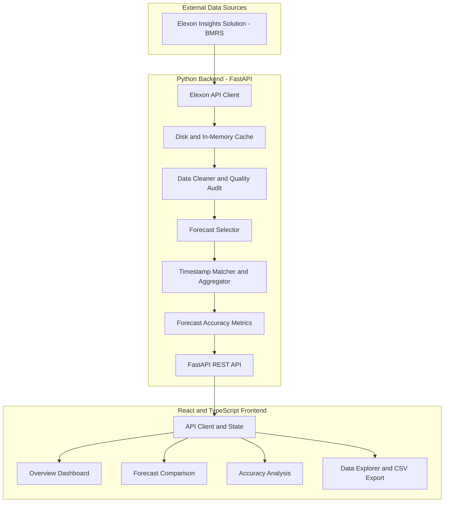

# WindForecast Analytics: UK National Wind Generation Day-Ahead Forecast Accuracy (January 2026)


**WindForecast Analytics** is a full-stack analytics platform for evaluating UK national wind-generation day-ahead forecasts against actual generation using official Elexon Insights Solution (BMRS) data.

The platform combines a Python FastAPI backend with a React and TypeScript dashboard to analyze forecast accuracy, apply configurable purchasing-decision cutoffs, inspect forecast publication histories, and examine data quality.

## Live Application

- **Live Dashboard:** https://windforecast-analytics.vercel.app/
- **Backend API:** https://windforecast-analytics.onrender.com
- **Interactive API Documentation:** https://windforecast-analytics.onrender.com/docs
- **Health Endpoint:** https://windforecast-analytics.onrender.com/health
- **GitHub Repository:** https://github.com/madugushivakumar/windforecast-analytics

The frontend is hosted on Vercel, and the backend is hosted on Render. These URLs are the configured deployment addresses; individual analytics features should be tested separately to confirm their current functionality.

---

## Table of Contents

1. [Project Overview](#1-project-overview)
2. [Business Problem](#2-business-problem)
3. [Key Features](#3-key-features)
4. [Technology Stack](#4-technology-stack)
5. [System Architecture](#5-system-architecture)
6. [Official Data Sources](#6-official-data-sources)
7. [Evaluation Scope and Decision Cutoff](#7-evaluation-scope-and-decision-cutoff)
8. [Data Cleaning and Resolution Alignment](#8-data-cleaning-and-resolution-alignment)
9. [Forecast Accuracy Metrics](#9-forecast-accuracy-metrics)
10. [January 2026 Results](#10-january-2026-results)
11. [Project Structure](#11-project-structure)
12. [Prerequisites](#12-prerequisites)
13. [Local Development Setup](#13-local-development-setup)
14. [Docker Setup](#14-docker-setup)
15. [Testing and Reproducibility](#15-testing-and-reproducibility)
16. [API Endpoints](#16-api-endpoints)
17. [Deployment Configuration](#17-deployment-configuration)
18. [AI Tools Disclosure](#18-ai-tools-disclosure)
19. [Limitations and Future Improvements](#19-limitations-and-future-improvements)
20. [Security and Data Integrity](#20-security-and-data-integrity)
21. [Submission Checklist](#21-submission-checklist)

## 1. Project Overview

WindForecast Analytics evaluates day-ahead wind-generation forecasts against actual UK national wind generation. It uses forecast publication timestamps to identify which forecast was eligible at a configured purchasing-decision cutoff.

The application provides a reproducible workflow for:

- Retrieving official forecast and actual-generation data.
- Cleaning and validating incoming observations.
- Selecting the latest eligible forecast vintage.
- Matching forecasts and actuals by delivery timestamp.
- Calculating quantitative forecast accuracy metrics.
- Reporting data coverage and quality issues.
- Visualizing forecast performance.
- Exporting analyzed observations for further examination.

The primary evaluation uses January 2026 purchasing-decision dates with a configurable Day-Ahead cutoff.

## 2. Business Problem

Wind generation is variable and weather-dependent. Differences between forecast generation and actual generation can create procurement uncertainty, volume risk, and potential electricity imbalance costs.

Energy procurement teams need to answer two important questions:

1. What was the latest eligible wind-generation forecast available when the purchasing decision was made?
2. How accurately did that forecast predict actual generation during the corresponding delivery periods?

WindForecast Analytics addresses these questions through cutoff-aware forecast selection, timestamp-based matching, statistical error calculations, and transparent data-quality reporting.

The platform provides analytical evidence of forecast performance. Forecast error metrics alone do not establish actual financial losses, imbalance charges, or achievable trading savings.

## 3. Key Features

### Official Elexon data ingestion

- Retrieves data from Elexon's Insights Solution (BMRS) endpoints.
- Supports FUELHH actual generation and WINDFOR forecast data.
- Uses bounded date-range requests and retry handling where implemented.
- Supports local caching for repeated analysis and reproducibility.

### Wind-only generation filtering

Actual-generation records are filtered using:

`fuelType == "WIND"`

This prevents records for other fuel categories from entering the wind-generation evaluation.

### Day-Ahead forecast selection

- Configurable cutoff hour and minute.
- Publication-time eligibility checks.
- Latest eligible forecast-vintage selection.
- Exclusion of forecasts published after the decision cutoff.
- Retention of publication timestamps for auditability.

### Interactive dashboard

**Overview**
- Executive KPIs.
- Forecast-versus-actual time series.
- Data coverage indicators.
- Commercial interpretation of forecast errors.

**Forecast Comparison**
- Delivery-window filters.
- Forecast-versus-actual comparison.
- Forecast vintage history.
- Cutoff eligibility inspection.

**Accuracy Analysis**
- Forecast error distribution.
- Residual error trends.
- Largest absolute discrepancies.
- Statistical accuracy metrics.

**Data Explorer**
- Paginated observations.
- Filtering and sorting.
- Forecasts, actuals, timestamps, and signed errors.
- CSV export of analyzed records.

### Data quality and provenance

The analytical workflow is designed to account for invalid records, duplicates, missing observations, and data-source provenance. Consult the generated audit artifacts for the actual counts and source information for a particular run.

## 4. Technology Stack

| Layer | Technologies |
|---|---|
| Frontend | React 18, TypeScript, Vite |
| Charts | Recharts |
| Icons | Lucide Icons |
| Backend | Python 3.11+, FastAPI, Pydantic |
| Data processing | Pandas, timezone-aware datetimes |
| HTTP client | HTTPX |
| Backend testing | Pytest |
| Frontend testing | Vitest, React Testing Library, JSDOM |
| Containerization | Docker, Docker Compose, Nginx Alpine |
| Frontend hosting | Vercel |
| Backend hosting | Render |

## 5. System Architecture

The application separates the user interface from the analytics engine. The frontend requests data from the FastAPI backend, which retrieves and processes source records before returning forecast comparisons and metrics.



### Processing flow

1. Retrieve actual-generation and forecast records.
2. Normalize timestamps to UTC.
3. Validate observations and filter actual generation to wind.
4. Resolve duplicate records according to the implemented rules.
5. Apply the decision cutoff to forecast publication timestamps.
6. Select the latest eligible forecast vintage.
7. Match forecast and actual delivery periods.
8. Aggregate half-hourly actuals for hourly evaluation.
9. Calculate accuracy metrics and coverage statistics.
10. Return results to the frontend.

## 6. Official Data Sources

### FUELHH — Actual generation

Official endpoint:

https://data.elexon.co.uk/bmrs/api/v1/datasets/FUELHH/stream

| Field | Description |
|---|---|
| `startTime` | Start of the settlement period |
| `publishTime` | Publication timestamp of the observation |
| `fuelType` | Fuel category |
| `generation` | Actual generation in MW |
| `settlementDate` | Settlement delivery date |
| `settlementPeriod` | Settlement-period index |

Only records with `fuelType == "WIND"` are included in the actual-generation evaluation.

### WINDFOR — Wind forecasts

Official endpoint:

https://data.elexon.co.uk/bmrs/api/v1/datasets/WINDFOR/stream

| Field | Description |
|---|---|
| `startTime` | Target delivery-period timestamp |
| `publishTime` | Forecast publication or vintage timestamp |
| `generation` | Forecast generation in MW |

The analysis depends on matching forecast and actual observations for the same delivery period.

Data provenance should be checked in the analysis manifest and data-quality outputs to establish whether a run used live API responses, cached records, or both.

## 7. Evaluation Scope and Decision Cutoff

### Primary evaluation: January 2026 decision dates

The primary decision-date window is:

- Start: `2026-01-01 00:00:00 UTC`
- End: `2026-02-01 00:00:00 UTC`, exclusive

Under the project's Day-Ahead D−1 modelling assumption, January decision dates correspond to delivery periods from January 2 through February 1, 2026.

The documented hourly delivery span is:

- Start: `2026-01-02 00:00:00 UTC`
- End: `2026-02-01 23:00:00 UTC`, inclusive

This represents 744 hourly periods.

### Alternative evaluation: January delivery dates

The alternative delivery-date window is:

- Start: `2026-01-01 00:00:00 UTC`
- End: `2026-02-01 00:00:00 UTC`, exclusive

This distinction matters because a January decision-date evaluation is not the same as an evaluation of delivery periods occurring strictly during January.

### Forecast cutoff eligibility

For delivery on day D, the project models the purchasing decision on day D−1.

The default decision cutoff is **11:00 UTC on D−1**. This is an operational purchasing assumption and is configurable; it is not a universal official deadline for every exchange or auction product.

A forecast is eligible when:

\[
publishTime \leq decisionCutoff
\]

The selected forecast is the eligible record with the latest publication timestamp:

\[
F_t = generation_{\arg\max(publishTime)}
\]

subject to the eligibility constraint.

Forecasts published after the decision cutoff must not influence the decision-time forecast.

Example analysis command:

```bash
python backend/reproduce_analysis.py --cutoff-hour 11 --cutoff-minute 0 --window decision --resolution hourly
```

Confirm the script's supported options before running the command if the implementation has changed.

## 8. Data Cleaning and Resolution Alignment

### UTC normalization

Timestamps are parsed and normalized to timezone-aware UTC datetimes before comparison and matching.

### Validation

Malformed timestamps and invalid generation values are subject to the implemented validation rules. Negative generation records should be audited and handled according to the project's data-cleaning policy.

### Duplicate resolution

Duplicate delivery-period records are resolved deterministically according to the implemented cleaning rules. The audit report should record how many duplicates were identified and resolved.

### Hourly aggregation

FUELHH actual generation is recorded at half-hourly resolution, while the documented primary evaluation uses hourly forecasts.

For each hour, the project calculates the arithmetic mean of the two half-hourly actual power observations:

\[
A_H = \frac{A_{H:00}+A_{H:30}}{2}
\]

where each input is a power observation in MW.

The resulting hourly average is compared with the matching hourly forecast. This averages power values rather than summing them as if they were energy.

The reported primary evaluation contains 744 matched hourly periods. Confirm actual coverage using the latest analysis artifacts.

### Half-hourly transparency mode

The documented transparency mode matches the forecast to the corresponding `:00` half-hour and reports the `:30` half-hour as missing a matching forecast rather than interpolating a value.

The previously reported result is 744 matched half-hours out of 1,488 expected periods, representing 50% coverage.

## 9. Forecast Accuracy Metrics

Let:

- \(F_t\) = forecast generation in MW.
- \(A_t\) = actual generation in MW.
- \(N\) = number of matched observations.

### Signed error

\[
e_t = F_t-A_t
\]

Positive values indicate over-forecasting; negative values indicate under-forecasting.

### Mean Absolute Error (MAE)

\[
MAE = \frac{1}{N}\sum_{t=1}^{N}|F_t-A_t|
\]

MAE measures average absolute forecast error in MW.

### Root Mean Squared Error (RMSE)

\[
RMSE = \sqrt{\frac{1}{N}\sum_{t=1}^{N}(F_t-A_t)^2}
\]

RMSE penalizes large errors more strongly than MAE and is measured in MW.

### Mean Signed Error (Bias)

\[
Bias = \frac{1}{N}\sum_{t=1}^{N}(F_t-A_t)
\]

Positive bias indicates that forecasts were higher than actual generation on average.

### Weighted Absolute Percentage Error (WAPE)

\[
WAPE =
\frac{\sum_{t=1}^{N}|F_t-A_t|}
{\sum_{t=1}^{N}|A_t|}
\times 100
\]

WAPE expresses total absolute error relative to total absolute actual generation. A zero denominator must be handled explicitly.

### Conditional Mean Absolute Percentage Error (MAPE)

The documented conditional MAPE calculation excludes observations where actual generation is below 100 MW.

For the eligible subset \(S\):

\[
MAPE =
\frac{100}{|S|}
\sum_{t\in S}
\left|\frac{F_t-A_t}{A_t}\right|
\]

The threshold and eligible sample count should accompany the metric because conditional MAPE does not represent every observation.

## 10. January 2026 Results

The values below are the previously reported project results. Reconcile them with the latest generated audit artifacts before treating them as independently verified final results.

### Primary mode: Hourly aggregation

| Metric | Reported result |
|---|---:|
| Expected hourly periods | 744 |
| Matched hourly periods | 744 |
| Reported coverage | 100% |
| MAE | 2,013.01 MW |
| RMSE | 2,505.94 MW |
| Mean signed error | +1,729.93 MW |
| Maximum absolute error | 6,833 MW |
| Minimum signed error | −4,128 MW |
| Maximum signed error | +6,833 MW |
| Error standard deviation | 1,814.25 MW |
| WAPE | 17.84% |
| Conditional MAPE | 21.61% |

Previously reported aggregates:

- Total absolute error: 1,497,682 MW-observations.
- Sum of actual hourly generation observations: 8,396,971 MW-observations.

These are sums of hourly power observations, not quantities of energy in MWh.

### Transparency mode: Half-hourly matching

| Metric | Reported result |
|---|---:|
| Expected half-hourly periods | 1,488 |
| Matched half-hourly periods | 744 |
| Reported coverage | 50% |
| MAE | 1,995.57 MW |
| RMSE | 2,498.82 MW |
| Mean signed error | +1,727.98 MW |
| Maximum absolute error | 6,857 MW |
| WAPE | 17.68% |

### Interpretation

The reported positive bias indicates that the selected forecasts exceeded actual generation on average under the project's signed-error convention.

MAE and RMSE quantify error magnitude, while WAPE expresses aggregate absolute error relative to aggregate actual generation.

These statistics do not, by themselves, quantify imbalance penalties, financial losses, or potential trading savings. Those require a separate validated model using applicable market prices and settlement rules.

## 11. Project Structure

The following illustrates the documented organization. Check the repository for the current exact file list.

```text
windforecast-analytics/
├── .env.example
├── .gitignore
├── docker-compose.yml
├── README.md
├── PROJECT_PLAN.md
├── REQUIREMENTS_TRACEABILITY.md
├── IMPLEMENTATION_STATUS.md
├── docs/
│   ├── ARCHITECTURE.md
│   ├── DATA_DICTIONARY.md
│   ├── DATA_ASSUMPTIONS.md
│   ├── TESTING.md
│   ├── DEPLOYMENT.md
│   ├── VIDEO_SCRIPT.md
│   └── SUBMISSION_CHECKLIST.md
├── backend/
│   ├── Dockerfile
│   ├── Procfile
│   ├── requirements.txt
│   ├── reproduce_analysis.py
│   ├── app/
│   │   ├── main.py
│   │   ├── core/
│   │   ├── schemas/
│   │   ├── services/
│   │   ├── analytics/
│   │   └── api/
│   └── tests/
├── frontend/
│   ├── Dockerfile
│   ├── nginx.conf
│   ├── package.json
│   ├── tsconfig.json
│   ├── vite.config.ts
│   ├── vercel.json
│   └── src/
│       ├── main.tsx
│       ├── App.tsx
│       ├── types/
│       ├── services/
│       ├── components/
│       ├── pages/
│       └── tests/
└── artifacts/
    └── january_2026/
```

## 12. Prerequisites

Install:

- Python 3.11 or later.
- Node.js 18 or later; Node.js 20+ is recommended.
- npm.
- Git.
- Docker Desktop and Docker Compose, if using containers.

Verify the installations:

```bash
python --version
node --version
npm --version
git --version
docker --version
docker compose version
```

Docker is optional for local development.

## 13. Local Development Setup

### Step 1: Clone the repository

```bash
git clone https://github.com/madugushivakumar/windforecast-analytics.git
cd windforecast-analytics
```

### Step 2: Configure environment variables

PowerShell:

```powershell
Copy-Item .env.example .env
```

Linux/macOS:

```bash
cp .env.example .env
```

Populate required settings according to `.env.example` and the application configuration. Do not commit secrets or credentials.

### Step 3: Install backend dependencies

From the repository root:

```bash
python -m venv .venv
```

Activate the environment in PowerShell:

```powershell
.\.venv\Scripts\Activate.ps1
```

Install dependencies:

```bash
python -m pip install -r backend/requirements.txt
```

### Step 4: Start the backend

```bash
cd backend
python -m uvicorn app.main:app --host 127.0.0.1 --port 8000 --reload
```

Local backend URLs:

- API base: http://localhost:8000
- Health check: http://localhost:8000/health
- API documentation: http://localhost:8000/docs

### Step 5: Start the frontend

Open a separate terminal:

```bash
cd frontend
npm install
npm run dev
```

Open the URL printed by Vite. The configured port may be 3000, 5173, or another available port.

If the frontend requires an API base URL, configure it using the actual environment variable read by `frontend/src/services/api.ts`.

## 14. Docker Setup

Ensure Docker Desktop is running.

From the repository root:

```bash
docker compose config
docker compose up --build
```

The documented local ports are:

- Frontend: http://localhost:3000
- Backend: http://localhost:8000

Check container status:

```bash
docker compose ps
```

Stop the containers:

```bash
docker compose down
```

Confirm the current `docker-compose.yml` before relying on the documented ports or service names.

## 15. Testing and Reproducibility

### Backend tests

From the repository root:

```bash
python -m pytest backend/tests -v
```

### Frontend tests

```bash
cd frontend
npm run test
```

### Frontend production build

```bash
cd frontend
npm run build
```

The previously documented results include five passing frontend tests. Backend counts have varied across project notes, so use the latest actual test output rather than assuming a fixed count.

### Reproduce the January 2026 analysis

From the repository root:

```bash
python backend/reproduce_analysis.py --cutoff-hour 11 --cutoff-minute 0 --window decision --resolution hourly
```

Check the script's supported arguments if the implementation has changed.

The documented workflow is intended to produce these audit artifacts:

| Artifact | Purpose |
|---|---|
| `analysis_summary.json` | Analysis configuration and reported metrics |
| `observations_analysis.csv` | Matched delivery-period observations |
| `data_quality_report.json` | Coverage and data-quality summary |
| `run_manifest.json` | Run metadata and integrity information |
| `validation_log.md` | Comparison with independent metric calculations |

The documented output location is `artifacts/january_2026/`. Confirm the actual output path after running the script.

A reproducible analysis should preserve its configuration, input data provenance, matching rules, observations, metric calculations, and validation output.

## 16. API Endpoints

The deployed API base URL is:

https://windforecast-analytics.onrender.com

| Resource | URL |
|---|---|
| API root | https://windforecast-analytics.onrender.com |
| Health endpoint | https://windforecast-analytics.onrender.com/health |
| Swagger UI | https://windforecast-analytics.onrender.com/docs |

The application documentation describes overview, forecast comparison, accuracy, and observation exploration capabilities.

Use the live Swagger UI to confirm exact routes, request parameters, and response schemas before integrating additional clients.

## 17. Deployment Configuration

### Frontend — Vercel

Live URL:

https://windforecast-analytics.vercel.app/

The frontend is configured as a Vite application rooted in `frontend/`.

If the API client reads `VITE_API_BASE_URL`, configure the production environment variable to:

```text
VITE_API_BASE_URL=https://windforecast-analytics.onrender.com
```

The variable name must match the implementation. Vite-prefixed variables are public in the browser bundle and must never contain secrets.

After changing environment variables, redeploy the frontend.

### Backend — Render

Live URL:

https://windforecast-analytics.onrender.com

The backend is configured as a Docker-based web service.

Verify:

- The container listens on the port expected by Render.
- The application binds to `0.0.0.0`.
- The health endpoint responds successfully.
- CORS permits the actual deployed frontend origin.
- The application can retrieve and process the required source data.

### Deployment verification

Open the frontend in an incognito browser and test the dashboard, forecast comparison, accuracy analysis, data explorer, and CSV export.

Check browser developer tools for failed API requests and CORS errors. A successful root response does not guarantee every analytics endpoint works.

## 18. AI Tools Disclosure

The previously documented development disclosure identifies:

**AI tools:** Google Gemini and Antigravity Agentic Coding Assistant.

**Reported assistance:** Project planning, documentation structure, initial code scaffolding, data dictionary preparation, mathematical test fixtures, TypeScript interfaces, and presentation scripting.

Review this section to ensure it accurately reflects the tools actually used and the work performed. Update it if necessary to meet the assignment's disclosure requirements.

## 19. Limitations and Future Improvements

### Forecast resolution

The documented primary evaluation compares hourly forecasts with hourly-aggregated actual generation. The transparency mode does not fabricate missing half-hourly forecasts.

### Decision cutoff assumptions

The default 11:00 UTC cutoff is an operational modelling assumption. Exchange-specific cutoffs must be verified against official market documentation before being described as official rules.

### National-level scope

The current focus is UK national wind generation. Regional wind forecasts, embedded generation, and local congestion are outside the documented core evaluation.

### Financial analysis

Forecast accuracy metrics do not independently establish financial impact. Financial modelling would require validated market prices, settlement data, applicable imbalance rules, and explicit assumptions.

### Potential enhancements

- More independently validated forecast vintages.
- Additional data-quality and schema-change monitoring.
- Configurable forecast horizons.
- Regional analysis where authoritative data is available.
- Financial impact analysis with documented assumptions.
- Continuous integration and scheduled regression tests.
- Monitoring of API availability and data freshness.

## 20. Security and Data Integrity

Before making changes to the public repository:

- Keep `.env` and other secret files out of version control.
- Review tracked files and Git history for credentials.
- Inspect cached datasets and generated reports for sensitive information.
- Do not expose private account details in documentation.
- Rotate credentials if exposure is confirmed.
- Confirm repository ownership and commit metadata if anonymity is required.

A `.gitignore` entry does not remove a secret that is already tracked or present in Git history.

## 21. Submission Checklist

- [x] GitHub repository exists.
- [x] Frontend deployment URL is available.
- [x] Backend deployment URL is available.
- [x] Backend root endpoint has returned a service-status response.
- [ ] Test every dashboard section and CSV export in an incognito browser.
- [ ] Reconcile test counts with the latest recorded test output.
- [ ] Verify analysis metrics against the latest audit artifacts.
- [ ] Confirm the README accurately reflects the current implementation.
- [ ] Resolve the assignment's anonymous repository requirement.
- [ ] Record and upload the required demonstration video.
- [ ] Verify the repository and video links.
- [ ] Complete the required Microsoft submission form.

**Submission form:** https://forms.cloud.microsoft/r/FTX6K2bbnU

The project should be marked fully submitted only after all required deliverables have been completed and verified.

---

*Documentation note: Deployment URLs above are the addresses supplied for this project. Reported January 2026 metrics and test counts should be reconciled with the latest source code, test output, and reproducible audit artifacts before being represented as independently verified results.*
